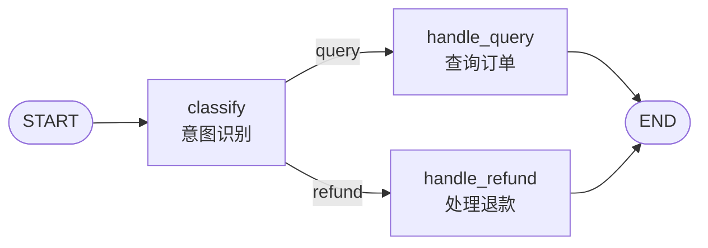

# 客服意图路由（intent-router）

基于 [LangGraph](https://langchain-ai.github.io/langgraph/) 的客服意图路由原型：识别用户一句话的意图（`query` 查订单 / `refund` 退款），再通过条件边分流到对应处理节点。

## 流程图



## 目录结构

```
intent-router/
├── router_agent/
│   ├── __init__.py       # 包声明
│   ├── state.py          # SupportState 状态定义
│   ├── nodes.py          # classify_node / handle_query / handle_refund
│   ├── routing.py        # route_by_intent 条件路由函数
│   └── agent.py          # 组装图、编译、导出 app
├── .env                  # 环境变量（原型阶段可暂空）
├── requirements.txt      # 依赖
└── langgraph.json        # 部署配置，指向 agent.py 中的 app
```

## 状态设计

`SupportState`（见 `router_agent/state.py`）：

| 字段 | 说明 |
| --- | --- |
| `user_input` | 用户输入的一句话 |
| `intent` | 识别出的意图：`query` / `refund` |
| `response` | 最终回复 |

## 安装与运行

需要 Python ≥ 3.10（已在 3.14 验证）。

```bash
python -m venv .venv
source .venv/Scripts/activate        # PowerShell 用 .venv\Scripts\Activate.ps1
pip install -r requirements.txt

python -m router_agent.agent
```

预期输出：

```text
{'user_input': '我的订单到哪了？', 'intent': 'query', 'response': '正在为您查询订单状态...'}
{'user_input': '这个我要退款', 'intent': 'refund', 'response': '已为您转接退款专员，请稍候。'}
```

> Windows 控制台默认 GBK，中文输出乱码时用 `PYTHONUTF8=1 python -m router_agent.agent` 运行。

在代码中调用：

```python
from router_agent.agent import app

app.invoke({"user_input": "这个我要退款"})
```

## 本地 Agent Server

```bash
# Git Bash
PYTHONUTF8=1 langgraph dev
```

```powershell
# PowerShell
$env:PYTHONUTF8="1"; langgraph dev
```

中文 Windows 上 `PYTHONUTF8=1` 是必需的：`langgraph-api` 读取内置文件时按系统默认编码（GBK）解码，不开 UTF-8 模式会直接报 `UnicodeDecodeError`。同样，`.env` 建议保持纯 ASCII，中文注释也可能被按 GBK 读取而报错。

`langgraph.json` 已声明图的入口（用模块形式，`agent.py` 里的相对导入才能生效）：

```json
{
  "dependencies": ["."],
  "graphs": {
    "agent": "router_agent.agent:app"
  },
  "env": ".env"
}
```

可用 `langgraph validate` 校验配置。
